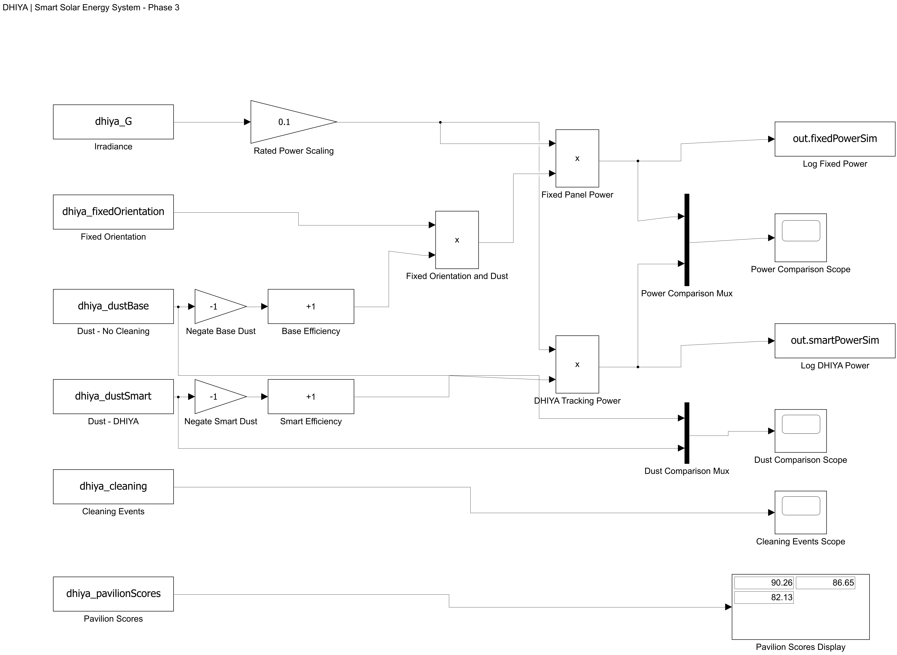

# DHIYA — MATLAB & Simulink simulation

This folder contains the MATLAB scripts, the Phase 3 Simulink model and the exported figures used to demonstrate the DHIYA smart solar concept. The model compares a fixed, uncleaned 100 W reference panel with DHIYA's condition-based cleaning and idealized tracking over a simulated 24-hour day, at one-minute steps.

The project's original notes are in [`README.txt`](README.txt), kept unchanged. This page summarises how to use the files. For a conceptual 3D illustration of the overall project, see [`docs/images/dhiya-3d-visualization.jpg`](../docs/images/dhiya-3d-visualization.jpg).

> **Illustrative simulation only.** All results come from simplified assumptions (sinusoidal irradiance, linear dust build-up, fixed cleaning effectiveness). They are not measured Expo pavilion data or experimentally validated performance. Tracking actuator energy is not included.

## Files

| File | Purpose |
|---|---|
| [`DHIYA_Phase3.slx`](DHIYA_Phase3.slx) | Main Simulink model. It takes irradiance, orientation, dust, cleaning and pavilion-score signals from the workspace and computes fixed-panel and DHIYA power. Output goes to scopes, a display and two `To Workspace` logs (`fixedPowerSim`, `smartPowerSim`). |
| [`DHIYA_Load_Data.m`](DHIYA_Load_Data.m) | Creates the six workspace inputs the model needs (`dhiya_G`, `dhiya_fixedOrientation`, `dhiya_dustBase`, `dhiya_dustSmart`, `dhiya_cleaning`, `dhiya_pavilionScores`) and prints the fixed and DHIYA daily energy. It doesn't modify the model. |
| [`build_DHIYA_Phase3.m`](build_DHIYA_Phase3.m) | Script that originally generated `DHIYA_Phase3.slx` block by block, then simulated it and plotted the results. **It stops with an error if `DHIYA_Phase3.slx` already exists**, so it never overwrites the model. |
| [`DHIYA_Control_Center_FIXED.m`](DHIYA_Control_Center_FIXED.m) | Self-contained interactive MATLAB dashboard (`uifigure`) with time-of-day and extra-dust sliders, live power, soiling and energy readouts, and an illustrative pavilion leaderboard. It computes its own data and doesn't use or control the Simulink model. |
| [`DHIYA_Simulink_Diagram.png`](DHIYA_Simulink_Diagram.png) | Exported diagram of the Phase 3 model. |
| [`DHIYA - Four Scenario Comparison.png`](<DHIYA - Four Scenario Comparison.png>) | Power over the day for the four operating scenarios. |
| [`DHIYA - Energy Results.png`](<DHIYA - Energy Results.png>) | Daily net energy for the four scenarios. |
| [`DHIYA - Smart Cleaning.png`](<DHIYA - Smart Cleaning.png>) | Soiling loss with and without condition-based cleaning. |
| [`README.txt`](README.txt) | Original project notes: methodology, assumptions, results and limitations. |

## Requirements

- **MATLAB R2026a** and **Simulink**. The model was saved in R2026a (Update 1), and `README.txt` lists this release. Older releases may not be able to open the `.slx`; that hasn't been tested.
- **No additional toolboxes** are referenced in the source files:
  - `build_DHIYA_Phase3.m` states that it needs "MATLAB and standard Simulink only", and it uses only blocks from the base Simulink library: From Workspace, Gain, Bias, Product, Mux, Scope, Display and To Workspace.
  - `DHIYA_Control_Center_FIXED.m` uses base-MATLAB app components (`uifigure`, `uigridlayout`, `uiaxes`, `uislider`).

## Getting the files

- **Whole repository:** on the [repository page](https://github.com/Saracs2/dhiya), choose **Code → Download ZIP** and extract it, or run `git clone https://github.com/Saracs2/dhiya.git`. The files are in the `matlab/` folder.
- **A single file:** open it in the [`matlab/` folder](https://github.com/Saracs2/dhiya/tree/main/matlab) and click the **Download raw file** button (the download icon at the top right of the file view). This works for `.slx` and `.png` files too.

Keep all the files in one folder: the model calls `DHIYA_Load_Data.m` when it starts.

## Running the Simulink model

1. Open MATLAB R2026a and set the **Current Folder** to this `matlab/` folder.
2. Open `DHIYA_Phase3.slx` (double-click it, or run `open_system('DHIYA_Phase3')`).
3. Click **Run**. The model's `InitFcn` callback runs `DHIYA_Load_Data` automatically, so the inputs are created before simulation. You can also run `DHIYA_Load_Data` yourself first, as described in `README.txt`.
4. Inspect the **Power Comparison Scope**, **Dust Comparison Scope**, **Cleaning Events Scope** and **Pavilion Scores Display**. The logged power signals are returned in the simulation output (`out.fixedPowerSim`, `out.smartPowerSim`).

The model runs 24 time units (one unit = one hour) with a fixed-step discrete solver at a step of 1/60.

## Running the scripts

| Command | What it does |
|---|---|
| `DHIYA_Load_Data` | Restores the model inputs and prints fixed and DHIYA daily energy, the number of cleaning events and cleaning energy |
| `DHIYA_Control_Center_FIXED` | Opens the interactive dashboard window |
| `build_DHIYA_Phase3` | Rebuilds the model from scratch. Only use this in a folder **without** `DHIYA_Phase3.slx`, for example after renaming the existing model, because the script refuses to overwrite it. Note that it starts with `clearvars`, which clears your workspace. |

## Results

`README.txt` reports these daily energy values for the four scenarios (cleaning scenarios include a 0.5 Wh per-cycle cleaning deduction; tracking motor energy is excluded):

| Scenario | Daily energy | vs conventional |
|---|---|---|
| A. Conventional PV (fixed, no cleaning) | 545.7 Wh | — |
| B. Smart cleaning (fixed) | 649.3 Wh | +19.0 % |
| C. Solar tracking (no cleaning) | 580.6 Wh | +6.4 % |
| D. Full DHIYA (tracking + cleaning) | 689.0 Wh | +26.3 % |

### Not included in this folder

`README.txt` (step 6) describes **`DHIYA_Final_Results.m`**, the script that evaluates the four scenarios and exports the three result figures above. That script isn't part of this package. The figures are included as exported images, but they can't be regenerated from the files here. Its scenario setup also differs from the included scripts; for example, the cleaning figure starts at 12 % soiling, while `DHIYA_Load_Data.m` starts at 0 %. `README.txt` also mentions an earlier `build_DHIYA_Phase2.m`, which isn't included either.

## Relationship to the web dashboard

The React dashboard in this repository ([live site](https://saracs2.github.io/dhiya/)) is a separate implementation. It doesn't run or connect to this MATLAB/Simulink model, and it uses its own documented assumptions (see the [main README](../README.md#model)). The two may therefore report different numbers. As `README.txt` notes, the Phase 3 model and the MATLAB Control Center also use different preliminary pavilion-scoring formulas.

## Not tested here

These files were added to the repository unchanged. MATLAB wasn't available when they were added, so the model and scripts haven't been re-run as part of this commit.
